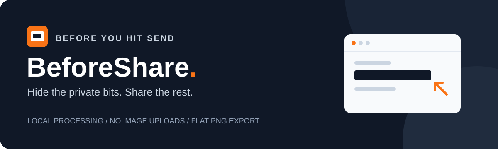
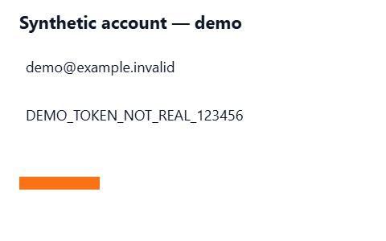
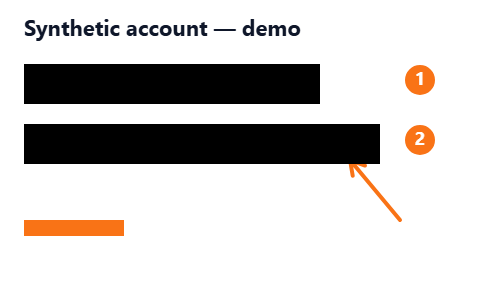
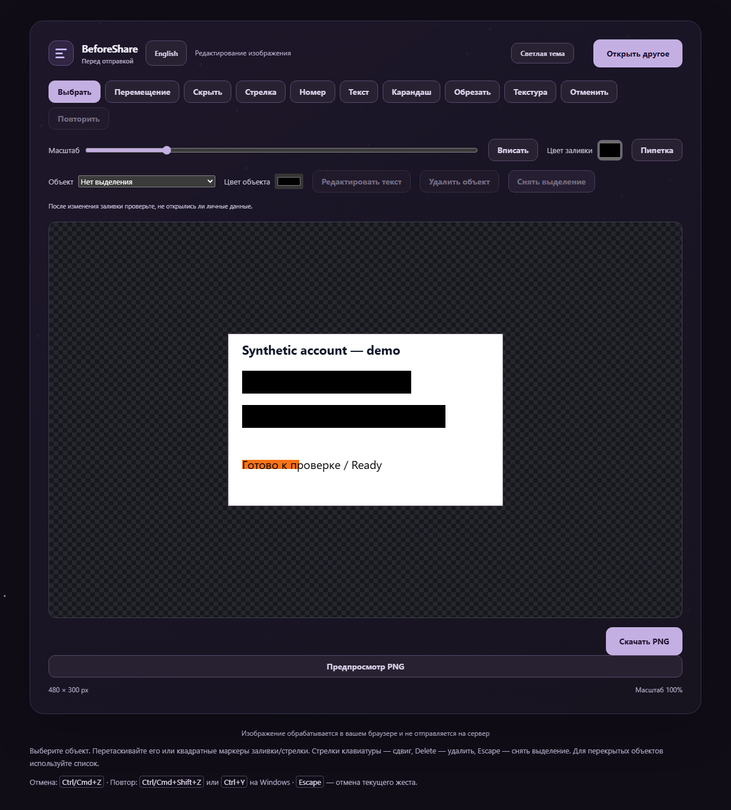
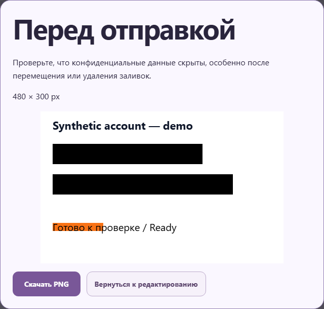

<p align="center">
  <a href="https://github.com/RegulusQuagmire/beforeshare/actions/workflows/ci.yml"></a>
  <a href="LICENSE"></a>
</p>

# BeforeShare — перед отправкой

[English documentation](README.en.md)

**Скрой личное. Поделись остальным.**

Локальный редактор скриншотов: закрой личные данные, добавь пояснения, обрежь лишнее и скачай готовый PNG. Обработка изображения выполняется на твоём устройстве, в браузере. Интерфейс доступен на русском и английском: переключатель English / Русский находится в шапке. Выбор языка сохраняется локально; смена языка не меняет изображение, подписи или историю.

**[Открыть BeforeShare](https://regulusquagmire.github.io/beforeshare/)** · [Исходный код](https://github.com/RegulusQuagmire/beforeshare)

Аккаунт переименован в RegulusQuagmire. Используйте новый адрес Pages выше; старый адрес сайта может не перенаправлять пользователей.

Базовый публичный сайт проверен 10 октября 2026 года в Chromium и Firefox: загрузка, скрытие данных, стрелки и номера, обрезка, отмена/повтор и скачивание PNG.

## Оформление и развитие

Две спокойные темы: тёмно-фиолетовая с медленно движущимися звёздами и линиями созвездий, светлая с мягкими лавандово-персиковыми градиентами. Кнопка переключения находится вверху приложения. Уменьшение движения отключает анимации; скрытая вкладка приостанавливает фон. Фон не перехватывает касания и не попадает в PNG. Интерфейс адаптирован к узким экранам, изображение показано на нейтральной подложке.

Идеи дальнейшего развития и их приоритеты: [IMPROVEMENTS.md](IMPROVEMENTS.md). Они не обозначают уже добавленные функции.

Смена темы сопровождается коротким плавным переходом. На устройствах с мышью активные кнопки слегка увеличиваются при наведении. Эти эффекты отключены при системном уменьшении движения и не влияют на пиксели PNG.

## Возможности

- Непрозрачное скрытие прямоугольником: выбор цвета и пипетка с изображения.
- Стрелки и нумерованные отметки для пояснений.
- «Выбрать»: перемещение объектов, размеры заливок и концы стрелок, цвет и удаление. Список объектов позволяет выбрать перекрытые элементы. Стрелки клавиатуры сдвигают объект; Shift увеличивает шаг; Delete удаляет, Escape снимает выделение.
- «Текст»: многострочные русские и английские подписи, размер и цвет, редактирование через окно с «Применить» и «Отмена». Системные шрифты не загружаются из сети.
- «Карандаш»: сглаженные штрихи мышью и пальцем; цвет заливки используется как цвет нового штриха. Толщина настраивается отдельно. Выбор позволяет переместить или удалить отдельный штрих.
- Обрезка с предпросмотром и отменой.
- Масштаб от 25% до 400%, прокрутка и кнопка «Вписать».
- Режим «Перемещение»: свободно двигайте увеличенную картинку пальцем влево, вправо, вверх и вниз; на компьютере — перетаскивайте мышью. Для редактирования снова выберите «Скрыть» или другой инструмент. Перемещение не меняет историю и PNG; Escape прерывает перетаскивание мышью.
- Замена простой текстуры соседним фрагментом, полностью локально, с предпросмотром «Применить / Отмена».
- Отмена и повтор до 50 действий.
- Экспорт в плоский PNG: без исходного имени файла, EXIF и текстовых метаданных.
- «Предпросмотр PNG» показывает итоговый файл с разрешением; скачивание из окна использует тот же PNG. Проверьте скрытые данные после перемещения, изменения размера или удаления защитных объектов.

## Пример

В примерах используются только вымышленные данные.

**До**



**После — PNG, скачанный из редактора**



<details>
<summary>Посмотреть интерфейс редактора</summary>





</details>

## Установка и запуск

Нужны **Git** и **Node.js 24 LTS** с npm.

```sh
git clone https://github.com/RegulusQuagmire/beforeshare.git
cd beforeshare
npm ci
npm run dev
```

В Windows PowerShell, если заблокирован `npm.ps1`, используй:

```powershell
npm.cmd ci
npm.cmd run dev
```

Выбери язык сообщений запуска: **1 — Русский** или **2 — English**. Открой адрес из консоли, обычно **http://127.0.0.1:5173/**. Оставь консоль открытой; `Ctrl+C` останавливает сервер. Если порт занят, освободи его или укажи `--port 5180`.

Запуск без вопроса о языке: `npm run dev -- --lang=ru` или `--lang=en`. Это выбор языка сообщений запуска; интерфейс редактора остаётся русским, а исходные сообщения Vite и компилятора сохраняют свой язык.

## Как пользоваться

1. Выбери PNG/JPEG, перетащи файл в окно или вставь изображение через `Ctrl+V` / `Cmd+V`.
2. Приблизь нужный участок. Инструментом «Скрыть» закрой личные данные непрозрачным цветом.
3. При необходимости добавь стрелки, номера и обрезку. Для простой текстуры используй инструмент «Текстура» и оцени предпросмотр.
4. Нажми «Скачать PNG» и проверь скачанный файл отдельно перед отправкой.

Отмена: `Ctrl/Cmd+Z`. Повтор: `Ctrl/Cmd+Shift+Z`, также `Ctrl+Y` в Windows. `Escape` отменяет незавершённое действие.

## Приватность

В production-приложении нет загрузки изображений на сервер, API-ключей, аналитики, внешних шрифтов или постоянного хранения картинок. Редактирование и подбор текстуры происходят в памяти браузера.

Незакрытые данные остаются видимыми. Отмена внутри редактора может восстановить исходное содержимое; в скачанный плоский PNG история не включается. Исходный файл на диске остаётся. Хостинг получает обычные запросы страницы и может видеть IP-адрес: локальная обработка не означает анонимность.

Подробнее: [проверка безопасности и её ограничения](PRIVACY.md).

## Ограничения

- PNG, JPEG и статичный WebP определяются по содержимому файла; APNG, анимированный WebP и JPEG с отложенной высотой не поддерживаются. Размеры заголовков проверяются до декодирования и повторно после него.
- Максимум **20 МиБ**, **20 миллионов пикселей** и **6000 пикселей по стороне**.
- Одно изображение за раз; замена требует подтверждения.
- Одно восстановление текстуры: до **1 миллиона пикселей**. Бюджет сохранённых текстур — **128 МиБ**.
- Масштаб меняет только просмотр; экспорт сохраняет исходное разрешение в границах применённой обрезки.
- Текстура копируется из подходящего соседнего участка без ИИ и облачных API. На сложном фоне возможны швы и повторения; идеальное удаление объектов не гарантируется.
- Текст: до 2000 символов, шрифт 8–200 px. Штрих: до 10 000 промежуточных точек, близкие точки отбрасываются. Толщина 1–80 px в координатах исходника. Защитные заливки и текстуры всегда рисуются поверх пояснений. Текстуры можно перемещать и удалять; изменение размера заплаток не предусмотрено.
- Отмена/повтор хранит 50 действий. Один законченный жест или применение текста — одно действие. Перезагрузка страницы теряет несохранённую работу; сохраняйте PNG перед закрытием.

## Технологии

**React 19 · TypeScript 6 · Vite 8 · Canvas 2D · Web Worker**. Проверки: **Vitest, Playwright, ESLint, TypeScript**. Публикация статического приложения: **GitHub Actions / GitHub Pages**.

## Проверки

```sh
npm run lint
npm run typecheck
npm run test:unit
npm run build
npx playwright install chromium firefox webkit
npm run test:e2e
```

В PowerShell при необходимости используй `npm.cmd` и `npx.cmd`. Playwright запускает production preview на порту 4183: полный набор Chromium, основные сценарии и новые инструменты в Firefox и WebKit. WebKit не заменяет проверку на физическом Safari/iOS. Мобильная эмуляция Firefox недоступна в Playwright; сенсорные сценарии выполняются в Chromium и WebKit. Проверяются история, ошибки загрузки, приватность PNG, совпадение предпросмотра и скачивания, темы и уменьшение движения. Результаты: [IMPLEMENTATION_PROGRESS.md](IMPLEMENTATION_PROGRESS.md).

## Production-сборка

```sh
npm run build
npm run preview -- --host 127.0.0.1
```

По умолчанию preview доступен по **http://127.0.0.1:4173/beforeshare/**. Vite preview предназначен для локальной проверки. В GitHub Actions путь определяется именем репозитория; для другого хостинга задай `VITE_BASE_PATH` при сборке и проверках. Подробнее: [RELEASE.md](RELEASE.md).

## Участие и лицензия

[Как внести изменения](CONTRIBUTING.md) · [Прогресс реализации](PROGRESS.md) · [Исходный план](beforeshare-plan.md)

Используй синтетические изображения в тестах и сохраняй локальную обработку и непрозрачное скрытие данных.

[MIT](LICENSE) © 2026 BeforeShare contributors.
